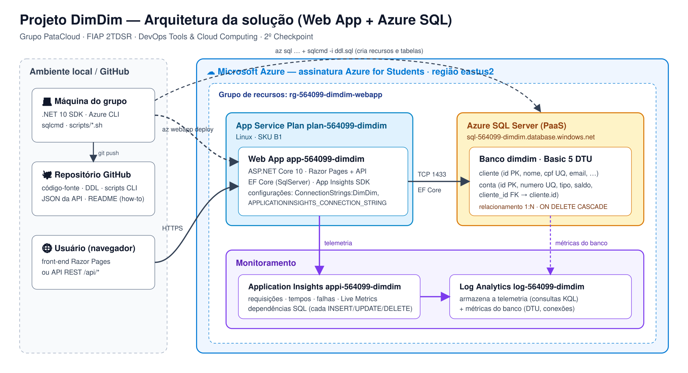

# Projeto DimDim — Web App + Azure SQL (2º Checkpoint)

Checkpoint de **DevOps Tools & Cloud Computing** (Prof. João Carlos Menk) — aplicação
web **.NET 10 (ASP.NET Core Razor Pages)** do estudo de caso **DimDim**, publicada no
**Azure App Service** com deploy automatizado por **Azure CLI + `az webapp deploy`**,
persistindo num **Azure SQL Database** (PaaS, não containerizado) e monitorada pelo
**Application Insights**.

## Grupo PataCloud — Turma 2TDSR

| RM | Nome completo |
|---|---|
| 564099 | Natalia Cristina de Souza |
| 564105 | Nickolas Davi Silva Souza |
| 565162 | Rodrigo Carvalho Silva |
| 565960 | Otávio Ferreira Barreto Santos |
| 566133 | Samara Vilela de Oliveira |

**Aplicação no ar:** https://app-564099-dimdim.azurewebsites.net

**Vídeo:** _LINK_DO_VIDEO_

---

## Descrição da solução

A DimDim precisa cadastrar seus **clientes** e as **contas** que cada um abre no banco.
A solução é um sistema web com **front-end** (telas de listagem, cadastro, edição e
exclusão) e, junto, uma **API REST** que expõe as mesmas operações em JSON.

- **Duas tabelas com relacionamento 1:N**: um `cliente` tem várias `conta`s
  (`conta.cliente_id` → `cliente.id`, `ON DELETE CASCADE`).
- **CRUD completo nas duas tabelas**, pelo navegador e pela API.
- **Azure SQL Database** como banco PaaS; as tabelas são criadas pelo DDL de
  [`scripts/ddl.sql`](scripts/ddl.sql).
- **Application Insights** recebe requisições, tempos de resposta, falhas e as
  **dependências SQL** — cada INSERT/UPDATE/DELETE aparece no mapa da aplicação.
- **Nenhum dado sensível no código**: a string de conexão do banco e a do Application
  Insights são injetadas como configurações do Web App pelo script
  [`04-criar-webapp.sh`](scripts/04-criar-webapp.sh); a senha vem de uma variável de
  ambiente exportada só no terminal.

| Camada | Tecnologia |
|---|---|
| Front-end | Razor Pages + Bootstrap |
| Back-end | ASP.NET Core 10, EF Core 10 (SqlServer) |
| API | Minimal API — `/api/clientes`, `/api/contas` |
| Banco | Azure SQL Database (Basic, 5 DTU) |
| Hospedagem | Azure App Service Linux (plano B1) |
| Monitoramento | Application Insights + Log Analytics |
| Deploy | Azure CLI + `az webapp deploy` (pacote zip) |

## Arquitetura



## Modelo de dados

```
cliente                              conta
-------------------------            ------------------------------
id            INT PK IDENTITY   1──N id            INT PK IDENTITY
nome          NVARCHAR(100)          numero        NVARCHAR(20) UNIQUE
cpf           NVARCHAR(14) UNIQUE    tipo          CORRENTE|POUPANCA|INVESTIMENTO
email         NVARCHAR(120)          saldo         DECIMAL(12,2)
data_cadastro DATETIME2              data_abertura DATETIME2
                                     cliente_id    INT FK → cliente.id
```

DDL completo: [`scripts/ddl.sql`](scripts/ddl.sql) · consultas usadas no vídeo:
[`scripts/consultas.sql`](scripts/consultas.sql).

## Estrutura do repositório

```
├── src/DimDim.Web/        código-fonte da aplicação (.NET 10)
│   ├── Models/            Cliente, Conta
│   ├── Data/              DbContext do EF Core
│   ├── Pages/             telas (Clientes/*, Contas/*)
│   └── Api/               endpoints REST
├── scripts/               DDL + scripts do Azure CLI (00 a 06, 99)
├── json/                  corpos JSON das operações GET/POST/PUT/DELETE
└── docs/                  desenho da arquitetura
```

---

## How to — implantação completa em nuvem

### 0. Pré-requisitos

- Conta Azure (Azure for Students serve) e **Azure CLI** instalada
- **.NET 10 SDK** — `dotnet --version`
- **sqlcmd** (go-sqlcmd) — https://github.com/microsoft/go-sqlcmd
- `zip`, `curl` e `python3` (já vêm no Linux/WSL/Cloud Shell)

```bash
git clone <URL_DESTE_REPOSITORIO>
cd dimdim-webapp
az login
az account show --output table          # confira a assinatura
```

### 1. Variáveis e senha

Todos os nomes de recursos estão em [`scripts/00-variaveis.sh`](scripts/00-variaveis.sh)
(RM da representante como prefixo, região `eastus2`). A senha do banco **não** fica em
arquivo — exporte só no terminal:

```bash
export SQL_PASSWORD='<senha forte: 8+ caracteres, maiúscula, minúscula, número e símbolo>'
```

### 2. Grupo de recursos

```bash
./scripts/01-criar-grupo.sh
```

### 3. Azure SQL (servidor, banco, firewall e tabelas)

```bash
./scripts/02-criar-banco.sh
```

Cria o **SQL Server** `sql-564099-dimdim`, o banco `dimdim` (Basic), libera o acesso dos
serviços Azure e do IP da sua máquina, roda o DDL e lista as tabelas criadas
(`cliente`, `conta`).

### 4. Application Insights

```bash
./scripts/03-criar-monitoramento.sh
```

### 5. App Service Plan + Web App + configurações

```bash
./scripts/04-criar-webapp.sh
```

Cria o plano Linux B1 e o Web App `app-564099-dimdim` com runtime `DOTNETCORE:10.0`, e
grava como configuração do app:

- `ConnectionStrings:DimDim` → string de conexão do Azure SQL
- `APPLICATIONINSIGHTS_CONNECTION_STRING` → conexão do Application Insights

### 6. Deploy

```bash
./scripts/05-deploy.sh
```

Faz `dotnet publish`, empacota em `app.zip` e publica com **`az webapp deploy --type zip`**.
Ao terminar, abra **https://app-564099-dimdim.azurewebsites.net**.

### 7. Testes do CRUD com persistência

**Pelo navegador:** menu **Clientes** → *Novo cliente* → editar → excluir; menu
**Contas** → *Nova conta* (escolhendo o cliente) → editar → excluir. Depois de cada
operação, rode no banco (Portal → banco `dimdim` → **Editor de consultas**, ou `sqlcmd`):

```sql
SELECT * FROM cliente ORDER BY id;
SELECT * FROM conta ORDER BY id;
```

**Pela API (automático):** o script abaixo faz POST, PUT, GET e DELETE nas duas tabelas
e mostra o `SELECT` no banco depois de cada operação:

```bash
./scripts/06-testes-crud.sh
```

### 8. Monitoramento

- Portal → `appi-564099-dimdim` → **Live Metrics** (requisições em tempo real enquanto
  você usa o site), **Application Map** (Web App → SQL), **Performance**, **Failures**.
- **Logs** (KQL):

```kusto
requests | where timestamp > ago(1h) | summarize count() by name, resultCode
dependencies | where type == "SQL" | project timestamp, target, data, duration, success
```

- Banco: Portal → `dimdim` → **Monitoramento → Métricas** (DTU, conexões).

### 9. Limpeza (depois da correção)

```bash
./scripts/99-apagar-tudo.sh
```

---

## API — operações e JSON

Base: `https://app-564099-dimdim.azurewebsites.net`

| Método | Rota | Corpo |
|---|---|---|
| GET | `/api/clientes` · `/api/clientes/{id}` | — |
| POST | `/api/clientes` | [`json/cliente-post.json`](json/cliente-post.json) |
| PUT | `/api/clientes/{id}` | [`json/cliente-put.json`](json/cliente-put.json) |
| DELETE | `/api/clientes/{id}` | — |
| GET | `/api/contas` · `/api/contas/{id}` | — |
| POST | `/api/contas` | [`json/conta-post.json`](json/conta-post.json) |
| PUT | `/api/contas/{id}` | [`json/conta-put.json`](json/conta-put.json) |
| DELETE | `/api/contas/{id}` | — |

**POST /api/clientes**
```json
{ "nome": "Steve Jobs", "cpf": "123.456.789-00", "email": "steve.jobs@dimdim.com.br" }
```
**PUT /api/clientes/1**
```json
{ "nome": "Steve Paul Jobs", "cpf": "123.456.789-00", "email": "steve@dimdim.com.br" }
```
**POST /api/contas**
```json
{ "numero": "0001-5", "tipo": "CORRENTE", "saldo": 1500.00, "clienteId": 1 }
```
**PUT /api/contas/1**
```json
{ "numero": "0001-5", "tipo": "POUPANCA", "saldo": 2750.50, "clienteId": 1 }
```
**GET /api/contas/1** → `200`
```json
{ "id": 1, "numero": "0001-5", "tipo": "POUPANCA", "saldo": 2750.50, "dataAbertura": "2026-10-05T23:18:14.9", "clienteId": 1 }
```
**DELETE /api/contas/1** → `204 No Content`

## Rodar localmente (opcional, só para desenvolvimento)

```bash
export ConnectionStrings__DimDim='Server=...;Database=dimdim;User ID=...;Password=...;TrustServerCertificate=True'
dotnet run --project src/DimDim.Web
```
